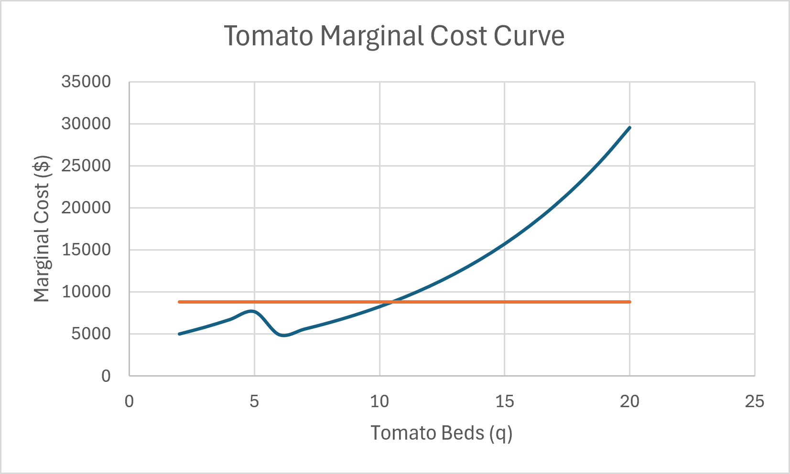
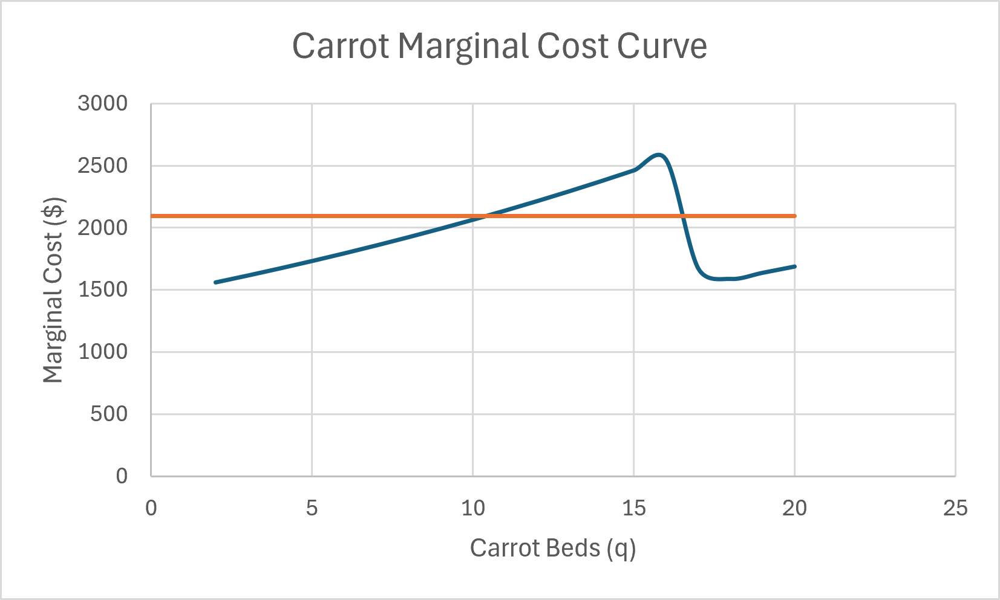

# Perfect Competition Analysis

## Where Does the Money Crop Stop, and Why?

Tomatoes generate the highest revenue per bed at $8,800. The Tomato Marginal Cost schedule shows marginal cost is approximately $8,248 at bed 10 and approximately $9,390 at bed 11.

Because the tomato price is $8,800, price is greater than marginal cost at bed 10 but lower than marginal cost at bed 11. This indicates that the profit-maximizing production level is approximately 10 tomato beds, where P ≈ MC.

This result is consistent with the Solver solution, which also selected 10 tomato beds.

## Tomato Marginal Cost Curve

- The tomato marginal cost curve crosses the tomato price line between beds 10 and 11.

## Carrot Marginal Cost Curve

- The carrot marginal cost curve crosses the carrot price line near 10 beds.

## Comparison with Initial Hypothesis

My original hypothesis predicted:
- Tomatoes = 7
- Carrots = 20
- Mesclun = 30

The Solver model found:
- Tomatoes = 10
- Carrots = 21
- Mesclun = 30

My original hypothesis predicted 7 tomato beds, 20 carrot beds, and 30 mesclun beds. The optimization model found 10 tomato beds, 21 carrot beds, and 30 mesclun beds. My hypothesis underestimated tomato production. The corrected Tomato Marginal Cost schedule shows that marginal cost remains below the tomato price at bed 10 and exceeds the tomato price at bed 11. This explains why the optimal solution includes 10 tomato beds.

## Which Constraints Bind?

The tomato bed cap does not bind: the model plants 10 of the 20 available tomato beds. Tomatoes stop at 10 because marginal cost passes the $8,800 price between beds 10 and 11.

The carrot bed cap binds: with the cap at 21, Solver plants all 21 carrot beds. The mesclun bed cap binds: Solver plants all 30 available mesclun beds.

The total bed constraint does not bind: the model uses 61 of the 64 beds. The labor constraint does not bind: total labor is about 5,352 hours against the 6,480-hour limit.

To value the two binding caps, I re-ran Solver with the cap raised by one bed. Solver's constraints now point at the Inputs sheet, so changing a cap there changes the solution.
- Carrot cap 20 to 21 (mesclun 30): Solver plants 10 / 21 / 30 and season profit rises from $42,775 to about $43,128. One more carrot bed is worth about $353.
- Mesclun cap 30 to 31 (carrot 20): Solver plants 10 / 20 / 31 and season profit rises from $42,775 to about $43,022. One more mesclun bed is worth about $247.

Both extra beds earn more than they cost. Carrot bed 20 costs $1,688 against a $2,094 price, and mesclun bed 30 costs $2,420 against a $2,700 price. So the shadow prices of the carrot and mesclun caps are positive, and the $0 values apply only to the bed and labor constraints that do not bind.

## Does Any Marginal Cost Curve Fall?

Yes. All three curves fall once, at the point where a crop's labor passes the farmer's 720 hours (Inputs B5). Hours up to 720 cost the farmer's rate of $34.72 per hour (Inputs B6). Hours beyond 720 cost the temporary-worker rate of $17.36 per hour (Inputs B9). Once a bed's hours are paid at the cheaper rate, the next bed costs less even though it needs more hours.
- Tomatoes: marginal cost falls from about $7,660 at bed 5 to about $4,906 at bed 6.
- Carrots: marginal cost falls from about $2,551 at bed 16 to about $1,675 at bed 17.
- Mesclun: marginal cost falls from about $2,988 at bed 13 to about $2,522 at bed 14, and to about $1,984 at bed 15.

This is not because the beds become easier to grow. Diminishing returns keep raising the hours each bed needs, and marginal cost climbs again after each dip.

The carrot dip is why the carrot answer is 21 and not about 10. Beds 11 to 16 each cost more than the $2,094 price, so each one loses money. The beds after the dip cost less than the price and earn more than the losses, so the 21 beds as a group still cover their variable cost.

## Would Each Crop Make Money on Its Own?

If the full fixed cost were assigned to a single crop, that crop might not make a profit on its own. However, the planting decision is based on marginal cost rather than fixed cost.

Fixed costs must be paid regardless of whether one more bed is planted. Therefore, the decision to plant another bed should compare price to marginal cost rather than price to average total cost.

Average variable cost (AVC) is labor cost plus fertilizer cost, divided by beds. Labor is priced in dollars first: hours are costed at $34.72 up to 720 hours and at $17.36 beyond, the same rule as the Marginal Cost sheet.
- Carrot AVC at 21 beds is about $1,910 per bed, against a price of $2,094.
- Mesclun AVC at 30 beds is about $2,431 per bed, against a price of $2,700.

Price still covers average variable cost for both crops, so production should continue even if fixed costs are ignored.

## Recommendation

The recommended planting strategy is:
- 10 Tomato Beds
- 21 Carrot Beds
- 30 Mesclun Beds

This combination produces the highest profit while satisfying labor, bed, and crop-cap constraints.

The model produced a season profit of approximately $43,128.
